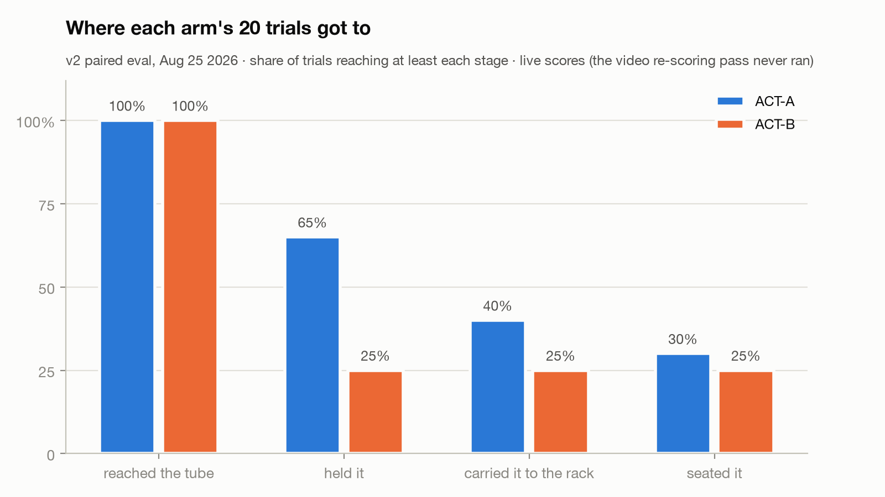
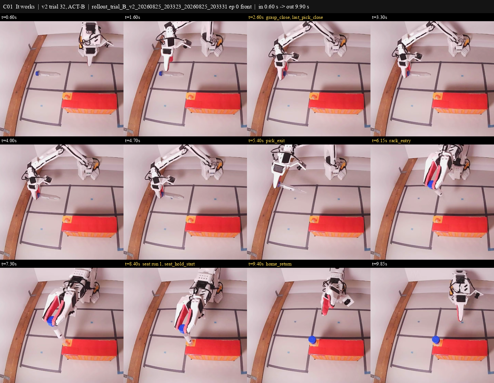

# so101-tube-insertion

Every servo on a LeRobot SO-101 arm reports its own load and current, and I wanted to know whether an imitation policy that can read those numbers gets better at a task where contact matters. The task I picked was lifting a 50 mL test tube off a marked spot and standing it in a rack, which fails in a different way depending on whether the arm reaches the tube, grips it, carries it, or seats it. Over the summer of 2026 I 3D printed a leader and follower pair, recorded my own demonstrations, patched the driver so the load and current of all six joints went into the observation, trained ACT with and without those channels on the same 49 episodes, and ran the two policies against each other on the real arm in paired trials.

The completed evaluation can't tell the two policies apart. The policy without load seated the tube 6 times out of 20 and the policy with it seated 5, and the interval around that gap rules out an improvement larger than about 25 percentage points. Most of what I learned came from the failures, because 27 of the 29 failed trials ended before the tube ever touched the rack, which is before the extra channels could have carried any information about contact. The full write-up, including the evaluation harness, the mistakes I made collecting recovery data, and everything the arm couldn't know about itself, is in [STUDY.md](STUDY.md).

There's a 41-second demo on the [releases page](https://github.com/FaithQin/so101-tube-insertion/releases) showing a first-try success, a recovery, and three of the ways the arm fails. Every clip in it is traced back to its source episode frame by frame in [analysis/demo_cut/EDL.md](analysis/demo_cut/EDL.md).

## What's here

The code that ran the bench is in [`tools/`](tools/), and the regression suite that grew alongside it is in [`tests/`](tests/). The offline evidence, meaning the held-out loss curves, the input ablations, the contact-frame comparisons, the π0.5 latency numbers, and the figures, is in [`analysis/`](analysis/). The documents at the top level are the record of the study as it happened, meaning the trial sheets for v2 and v3, the v2 pre-registration, the start schedule for each dataset, the DAgger design I wrote and never ran, and the notes I took on recording protocols from the literature.

| path | what it holds |
|---|---|
| [`STUDY.md`](STUDY.md) | the write-up |
| [`tools/`](tools/) | bench scripts for preflight gates, homing, replay, scoring, and telemetry, the v4 analysis, and the four site-packages patches the study depends on |
| [`tests/`](tests/) | the regression suite, with one test file per bug that cost bench time ([`TESTING.md`](TESTING.md) says which) |
| [`analysis/`](analysis/) | hold-out verdicts, ablations, contact-frame loss, π0.5 latency, the figures, and the demo cut |
| [the v2 trial sheet](<Eval Trials %E2%80%94 v2 paired blocks.md>) | every v2 trial with its live score and notes, with [the v3 sheet](<Eval Trials %E2%80%94 v3 paired blocks.md>) beside it |
| [the v2 protocol](<Eval Protocol %E2%80%94 ACT AB.md>) | the pre-registration, written on August 24 before the first trial |
| the start schedules | the recording plan for each dataset, one file per dataset |
| [the DAgger design](<Eval Design %E2%80%94 DAgger single-arm before-after.md>) | the follow-up I designed and didn't run |
| [the methodology notes](<Methodology %E2%80%94 recording protocols from the literature.md>) | reading notes on recording protocols from the literature that shaped the recording rules |
| [`PROVENANCE.md`](PROVENANCE.md) | how this public snapshot was cut from the private working repository |

## The result

v2 ran on August 25, 2026 as 20 paired trials per arm, with both policies trained on the same 49 demonstrations and run on the same rig in alternating pairs. ACT-A saw the camera images and the six joint positions. ACT-B saw the same plus the load and current of every joint, so its state had 18 numbers instead of 6, and that was the only difference between them.

| arm | seated | 95% interval (Clopper-Pearson) |
|---|---:|---|
| ACT-A, positions only | 6 of 20 | 11.9% to 54.3% |
| ACT-B, positions plus load and current | 5 of 20 | 8.7% to 49.1% |

Three of the discordant pairs went A's way and two went B's, so the pre-registered McNemar test gives p = 1.00 in its exact form and 0.69 as a mid-p. I had planned 80 pairs and stopped at 40 after looking at the data, which makes the stop post hoc, and the later v4 protocol added a rule against doing exactly that. The failure breakdown is where the trials said something. Eighteen trials never grasped the tube, six lost it from the jaws, two pecked at it, two jammed at the rack, and one was a slip or a miss that only the video could have settled. [STUDY.md](STUDY.md) goes through all of it, including what the policies did with the extra channels offline.

## Reproducing the setup

The study runs on upstream LeRobot 0.6.1 with four local patches, all in `tools/`. [`so_follower_load.patch`](tools/so_follower_load.patch) reads `Present_Load` and `Present_Current` on all six joints into the observation and adds the gripper stall protection. [`sync_queue_skip_patch.py.txt`](tools/sync_queue_skip_patch.py.txt) skips per-tick preprocessing while ACT is serving from its action queue, and the two `rollout_context_*` patches route the extra channels into the state a policy expects. Episodes recorded without the first patch can't be retrofitted, because the load and current were never written.

The training configs for the six v4 policies are in [`tools/train_configs/v4/`](tools/train_configs/v4/), with the dataset manifest in [`tools/v4_manifest.json`](tools/v4_manifest.json) and the split in [`tools/v4_training_split.py`](tools/v4_training_split.py). The checkpoint each policy would have run on the bench was fixed by a rule declared before I looked at the curves in [`analysis/v4_holdout/`](analysis/v4_holdout/), which put ACT at 40,000 steps, π0.5 at 20,000 for A and 15,000 for B, and SmolVLA at 5,000. The datasets and checkpoints themselves are on the Hugging Face Hub and stay private for now.

The tests run with `pytest tests/` from the repo root in the LeRobot environment, and none of them need the arm or the cameras. Expect skips and failures for anything that reads this rig's calibration, the cached datasets, the patched site-packages, or a file that was held back from this snapshot. [`TESTING.md`](TESTING.md) lists what each file pins and the bench-time bug it came from.

## Hardware

The arm is a 3D-printed SO-ARM101 leader and follower pair with Hiwonder HX-30HM servos on the follower (they report as Feetech STS3215 on the bus) and HX-10HM on the leader, each arm on its own 12 V 5 A supply. Two USB cameras record at 20 fps, a fixed front camera at 1280×720 and a wrist camera at 640×480. A Mac laptop runs teleoperation, recording, and inference on Apple's Metal backend, and training ran on rented H200s through Hugging Face Jobs. The whole arm cost about $300.

## Status

The completed evaluation is v2. A larger pre-registered study, v4, was frozen on September 6, and its bench stopped on September 17 after a two-pair pilot, when the worn elbow could no longer pass certification. I closed the study at the pilot on September 22, the week classes started, and the blinding key for v4 is still sealed. The pilot, the unsealed key, and the v4 protocol text aren't in this snapshot. If I publish them it will be as a dated addendum.

## License

Apache-2.0. This repository is a snapshot of my private working repository at commit `2f27e70`, cut by an allowlist on October 7, 2026. [`PROVENANCE.md`](PROVENANCE.md) lists every file that was copied and every edit made to it.
