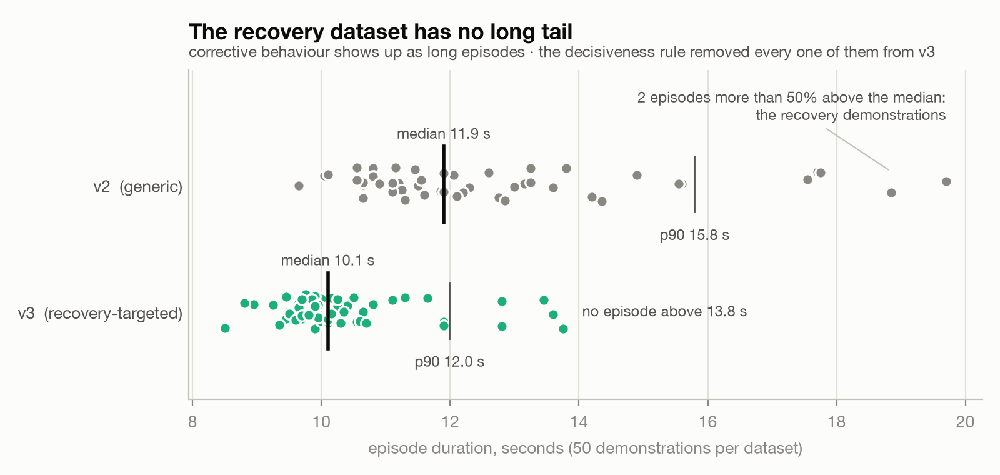

# Does servo load help an imitation policy seat a test tube?

This is the write-up of the study behind this repository, for anyone who wants to know what was actually tested, what the numbers can and can't support, and what went wrong on the way. The short version is in the README. Section 1 covers the question and the result, section 2 covers the harness that made the numbers believable, sections 3 to 5 cover what I learned about demonstration data, about the arm itself, and about chunked policies, and section 6 lays out the bets I'd carry into a next study alongside the gaps in this one. The scoring taxonomy and the full v2 table are at the end.

## 1. The question and the result

Every servo on this arm reports how hard it's working, as a load value and a current value, and I wanted to know whether an imitation policy gets better at a contact-rich insertion when it can read those numbers. ACT-A never sees them. ACT-B sees them for all six joints, so its state is 18 numbers instead of 6, and that is the only thing I changed. Both policies trained on the same 49 demonstrations, on the same rig, for the same task, which is to pick a 50 mL test tube up from a marked spot and stand it in a fixed rack. I counted a trial as a success when the tube was standing in the hole, unsupported, at the end of the episode.

I pre-registered the v2 evaluation on August 24 as 80 paired trials, with a success rate per arm, Clopper-Pearson intervals, and McNemar's test on the matched pairs. I stopped at 40. I made that futility call after looking at the data, so the stop was post hoc, and the v4 protocol later added a rule against exactly that.

| arm | seated | 95% interval (Clopper-Pearson) |
|---|---:|---|
| ACT-A, positions only | 6 of 20 | 11.9% to 54.3% |
| ACT-B, positions plus load and current | 5 of 20 | 8.7% to 49.1% |

Three discordant pairs went A's way and two went B's. On a 3 to 2 split the exact version of the pre-registered McNemar's test gives p = 1.00, and the mid-p version, which I chose for the later studies, gives 0.69. The bound I quote comes from an unpaired interval on the gap between the two success rates, and it says I can rule out an improvement from adding load and current larger than about 25 percentage points at 95%. A paired Newcombe interval on the same 20 pairs is tighter, at about 17 points, and I report the wider one. Either way the interval is wide, because twenty trials per arm is a small number.

The stage letters in the v2 sheet are the live scores I gave as each trial ran. The pre-registration made a second pass from video the ground truth, and that pass never happened.

Where the trials did teach me something was in where things went wrong. 27 of the 29 failures ended before the tube reached the rack. Eighteen never grasped the tube, six slipped out of the jaws, two pecked at it, two jammed at the rack, and one was a slip or a miss that the video pass would have decided. ACT-A failed 14 times, and in 7 of those it got a hold on the tube and still failed, with 5 of those holds scored as marginal. ACT-B rarely held the tube at all, since 13 of its 15 failures never held it. All of that describes twenty live-scored trials per arm, so I treat it as a lead for the next study.

## 2. What it took to believe any number

A deterministic replay of a known-good demonstration separates the plant from the policy, and without one, "my policy is bad" can't be falsified on a hobby-servo arm. From August 23 a replay had to seat the tube before every block of trials, and from September 1 no trial counted unless a replay had passed on the same power cycle. That rule earned its keep three times. The replay caught an elbow fault on August 29, it certified the plant on September 3 after two days in which nothing had seated, and on September 6 it stopped seating on its own, which is how I found the worn elbow gearbox described in section 4.

The gates came out of a single bad evening. On August 29 I lost about an hour of bench time to checks that only printed a warning, so since then any condition that should stop a launch stops it in code, and any condition that shouldn't isn't in the launcher at all. The thresholds live in [`tools/preflight.py`](tools/preflight.py), [`tools/home_gate.py`](tools/home_gate.py), and [`tools/cert_gate.py`](tools/cert_gate.py), and each one was written after a specific thing went wrong.

| gate | threshold | what it came from |
|---|---|---|
| tube placement | within 8 px of the reference frame | an episode ran at 10.2 px because the number was printed and never enforced |
| home pose | each joint within mean ± 1σ of the training set's frame 0 (v4 elbow 85.61 ± 2.74°) | the elbow homed at 74.1°, below the v2 training floor, and a replay sailed past the tube |
| joint temperature | every joint at or below 60 °C, and an unreadable temperature refuses | a 69 °C elbow brownout, then a 68 °C wrist that an elbow-only gate let through |
| start state | frame 0 must not show the cap already seated | an episode began seated and was reset seven seconds into recording |
| telemetry | sidecar rows equal recorded frames, all six load channels live | one training episode had frozen load columns |
| pair parity | both halves of a pair run the same action-chunk setting | the v4 protocol |
| checkout | scored trials run from the main checkout only | a probe ran on a stale copy of the tools |

Scoring was the weakest part of v2. The pre-registration called for a live pass and then a pass from video, with video as ground truth, and the video pass never ran. From August 29 [`tools/score_episode.py`](tools/score_episode.py) scored each episode's own recording, reporting "seat runs" and flagging any episode that started with the tube already seated. A seat run is a count of frames in which the cap sits inside a box on the image, and it can be wrong. On one probe the arm reached the funnel and couldn't insert, and every seat run the scorer counted was either the dropped tube lying beside the rack or my hand during a reset. The evidence sheet for that one is [`analysis/demo_cut/B2V-A-02_seat_runs_evidence.png`](analysis/demo_cut/B2V-A-02_seat_runs_evidence.png). For v4 the scoring moved offline, with episodes hashed and shuffled, a blinded re-score of 20% of them after 48 hours, and a weighted kappa gate of 0.75.

The pre-registrations, in the order I wrote them:

1. v2, August 24. Success rate with Clopper-Pearson intervals and McNemar, two-pass scoring. Stopped at 40 of 80.
2. The priming confirmation, August 27. Criterion 8 of 10. Result 5 of 10, not confirmed.
3. v3, August 29. 40 pairs plus a 20-trial chunk-lock arm, fixed n, mid-p McNemar. Abandoned on a floor effect before any scored trial.
4. v4, September 6. Frozen before trial 1, with the forbidden sentences and the power table written before any data existed. The SHA-256 of the frozen text is `e4011b90100d4014dba47148528162a23debaec6198b8980248c1a2fdfe2cca7`, and the current text with its dated amendments is `8ed49730af16814c78d5a6bcc2c2c967e32f1becac7bc4ed3d28a351de63a0a9`. The text goes out with the addendum.

Eight times over the summer something looked like a model result and turned out to be infrastructure, and the pattern was consistent enough that on a physical rig I now assume the odds that the model is the problem are much lower than they feel. Before August 22, every probe shredded into fragments of 2 to 17 seconds, which looked like the policy re-recording or skipping episodes and was actually mouse-wheel scroll arriving as arrow-key escape sequences in a raw-mode terminal. The 12 to 15 Hz control loop I quoted for a day was the log printing 1/dt for each single overrunning tick. A failing elbow servo was homing backlash, with one command landing 1.5° apart depending on the direction it approached from, and that reopened the spare-servo question on September 6 when real wear was measured. The policy starting out of distribution in the early v3 probes was the follower's connect call moving the wrist roll by 1.62°, repeatable to 0.09°. Two more cases never cost anything because the code was read before it ran. π0.5 would have looked unable to do the task because load and current were routed into state dimensions the model had trained as zeros, and bf16 would have looked broken on Apple Metal because of a blanket dtype cast in my own benchmark, which a second device disagreed with. The two expensive cases were both deltas measured without a baseline. A leader-to-follower offset that I read as a 10° horn slip and patched into the servos cost a bench evening, a 69 °C wrist, six configurations, and zero seats before I withdrew it, and a two-day plant fault turned out to be the diagnostics normalising joints to a ±100 range while production used degrees, so the instruments measured their own unit gap and called it a fault. I now treat a delta without a baseline as no evidence of change at all.

Beyond those eight, a number of things I believed got a direct test and didn't survive it. I thought a start-state mismatch explained ACT-A's failures, so I perturbed one observation dimension offline and diffed the predicted chunk, and the action changed by at most 0.04°, which means the policy is vision-dominated and the idea is dead. I thought a good previous trial primed the next one, so I pre-registered a 10-cycle confirmation with blind camera scoring and got 5 of 10 against a criterion of 8. I thought the control loop ran at 12 to 15 Hz, and 1156 frames in 60 seconds of log timestamps is 19.3 Hz. I thought the elbow and wrist horns had slipped by about 10° and 7°, and a hard-stop encoder sweep against the August 7 calibration put every stop within 1.6°. I thought a changed EEPROM register explained the elbow's 3° settle error, and every register on all six servos was identical side by side. I thought π0.5 and SmolVLA had measured control rates, tried to source both, and found that neither had ever been measured, so ACT's 19.62 Hz is the only clocked rate in the study. I thought the B policies ignored the 12 extra channels, and an input ablation on held-out frames showed ACT-B's chunk moving 1.56 times more for load and current than for positions. I thought π0.5-B predicted contact-frame actions better, and the same test at the pre-declared checkpoints over three seeds gave a difference of 0.002 ± 0.005. I thought the VLAs' grasp pose sat within one standard deviation of training, so that "rode too high" was unsupported, and comparing against what reaches the tube today showed a 6.4° elbow gap, so I retracted that too.

Every bug that cost bench time became a test the same day, and a green test proved nothing until a mutation made it red. The suite started at 32 tests on August 29, and `pytest --collect-only -q tests/` prints how many this snapshot holds. You can't run all of it, because the tests that read this rig's calibration, the cached datasets, or the patched site-packages skip or fail anywhere else, and the tests that pin the sealed key are held back until the addendum.

## 3. The recovery data that taught the wrong thing

For v3 I recorded 50 new demonstrations. Thirty were ordinary takes, and the other 20 targeted failure states I had measured on the bench. In ten of them the tube started rotated, in five it started nudged off its mark, and I set the tube into those states by hand before each take. In the last five the tube started on its mark and I copied the policy's hover to the left of the cap before correcting onto it.

So only 15 episodes started in a staged bad state, and in those the arm never saw how the tube got there, which is the moment where a policy would learn to notice that something had gone wrong. The recording rule made it worse. Every take had to be decisive, and I redid any take that felt hesitant, but a recovery is a hesitation followed by a correction, so my own rule removed the behaviour the dataset was meant to capture. You can see it in the durations, because episodes with a correction in them run long. v2 has a median of 11.9 s and two long recovery episodes, while v3 has a median of 10.1 s and no long episodes at all.

What I should have done is let the policy make the mistake and record only my correction, which is what DAgger does. I wrote a single-arm before-and-after design for it in [the DAgger design document](eval-design-dagger-before-after.md) and never ran it.

Once the plant was verified I ran two probe trials per arm on v3. The A policy grasped the tube both times and failed to insert it both times, and the B policy didn't grasp it in either trial. That fits the v2 split, and two trials per arm can't say more than that. No v3 trial was ever scored under its pre-registration.

This is a finding about how I curated the data. For v4 I changed the recording rules so that the arm itself creates every bad state during the episode, and I don't yet have a bench comparison of the two approaches.

## 4. What the arm can't know about itself

A cold follower executes the same absolute-position commands about 1 cm higher than a warm one, which is enough to miss every grasp of a 30 mm tube, and position feedback only ever reports the servo's own belief about where it is. Two warm-up replays before every block are part of the protocol because of this. Backlash is on top of that, since one home command landed 1.5° apart depending on the direction it arrived from. The elbow also settles about 3.07° from its command at both anchors I measured, folded and extended, under opposite gravity loading, and after checking the configuration, the calibration, and every EEPROM register and finding them identical, I've left that as an open reading.

Positional accuracy under gravity was a lesson from the first week. A position error of about 19 raw counts produces too little torque to break static friction, so a joint commanded to creep forward freezes and looks exactly like an obstruction, while an error of about 7 counts falls inside the servos' deadband. Gravity-loaded joints need about 8 units of lead and stop about 6 short of a raised target. On this arm, positional accuracy under load is several degrees no matter how good the policy is.

Measuring from the camera has its own trap. The arm fills a large part of the fixed camera's frame and can't return to the same pose twice because of the settle error, so a stroke that touched nothing once scored 58,150 changed pixels of "movement", or 6.3% of the frame, simply because the arm ended somewhere else. Three early "successes" were the arm, the operator sitting in frame, and a real replay misread as a failed push. The rule that came out of it is to capture before and after with the arm parked outside the object's region and to read the bounding box of what changed, because the bounding box says what moved.

The worn elbow gearbox showed up on September 6. Replaying a v4 episode's exact commands, the loaded end-effector proxy sat at −5.15° against −3.11° while recording, and three replays agreed to a hundredth of a degree. Voltage, fault flags, gains, limits, temperature, calibration, and warm-up were all ruled out by measurement. Commanding 4.9° further bought 0.44° of travel while load rose from 168 to 368, and with torque off the joint moves in bumps, one per gear tooth. Homing now approaches the elbow from above, which compensates for the wear without fixing it. Open-loop replay no longer seats, but a closed-loop policy still can, because it sees the wrist camera at 20 Hz and corrects for being low. Both arms of the study run on the same plant, so the paired contrast survives while the absolute success rates are depressed.

There was also a thermal budget nobody was watching. Holding the home pose with torque on through 25 minutes of software work took the wrist flex servo from 45 to 68 °C at a steady load of 260, one degree under the brownout, while the gate read only the elbow. Every joint is gated now.

What the load channels actually carry is the part that bears on the question. The gripper's load reading saturates at 500, its torque limit, so contact force is right-censored exactly when it matters. Offline, on held-out frames, freezing the load and current channels at their training mean moved the predicted chunk more in contact frames than in free frames, by about 15% for ACT-B and SmolVLA-B and about 40% for π0.5-B (ACT-B 3.20° against 2.79°, SmolVLA-B 7.46° against 6.47°, π0.5-B 6.95° against 4.97°). A "contact frame" here is one where a distal load reading sits far from its training mean, which is a threshold on load, and no contact in those frames was verified. Freezing the position channels instead moved ACT-B's chunk 1.85°, so ACT-B leans on load and current 1.56 times more than on positions. My reading is that the B policies use the channels as a state signature spread across every frame, carrying which episode, which phase, and how warm the servos were, and the pre-registered contact anchor, an onset in distal load, never fires inside a training rack window. The confound is worth naming before a reviewer does. robomimic's section 4.3 found that adding low-dimensional information the task doesn't need cost image-based agents 2 to 29% in relative performance, and B adds 12 dimensions to A's 6.

## 5. The re-planning window, the chunk lock, and π0.5 on a laptop

ACT predicts a chunk of actions and executes some of them before predicting again, and I tried four settings for how many. The 10 and 100 points ran on the first ACT-A policy, before v2 existed and before the arrow-key fix in section 2, and the other two ran on ACT-A-v2. Executing 10 actions per chunk collapsed motion, with 5 to 24 units of joint travel in 42 seconds and the arm trembling in place. Temporal ensembling with a forward pass every tick reached the tube, closed partway, and hovered for 35 seconds. Executing 25 was bimodal, either a success or a peck loop, and executing 100 overshot blind. At 25 the peck is locked to chunk boundaries. The lift joint moved 6.35° per tick at boundary ticks against 0.87° elsewhere, and five episodes in a row produced 66, 67, 67, 67, and 67 lift reversals, two per chunk.

The name for the symptom comes from Sherry Chen's SO-101 ACT post on the Hugging Face blog, which calls it the woodpecker. Her diagnosis list, paraphrased, runs through cameras that moved between training and evaluation, a camera angle that hid the grasp, a redone calibration, a handful of memorised positions, no evaluation set, and watching the follower while recording. Here the scene and camera are pinned by the placement gate, the calibration by EEPROM readback, and the position is single by design, but there was no evaluation set until v4 and neither the camera angle nor my own gaze during recording was addressed. So the chunk-boundary reading is one candidate cause for a symptom that has several, and I'm claiming no more than that.

Denying re-planning during a closing onset, which I called the chunk lock, went 5 of 5 seated with the lock on against 3 of 5 with it off, and Fisher's test on that gives p = 0.44. The lock extended a chunk in only 3 of the 5 on-trials, both off-failures fell at cold moments, and after 17:43 everything seated regardless, so it was never demonstrated, and it's off in v4.

A 50-action chunk is 2.5 seconds of robot time at 20 Hz, so the budget for π0.5 is 2.5 seconds per forward pass. On an M5 Pro's Metal backend the fine-tuned π0.5 predicts a chunk in 0.678 s at p90, and a rented RTX 3090 does it in 0.338 s. Both fit with more than three times headroom, which means a 2.3 billion parameter model runs the loop on the laptop. That measurement is a forward pass on synthetic observations, so it's a latency and says nothing about the control rate. Offline, the same policy reproduces demonstrated actions with a normalised error of 0.035, against 0.099 for simply copying the current position.

On the arm, π0.5-A on v3 went 0 of 3 valid probes, the tube never moved, and every trial was a peck. SmolVLA-A on the same data displaced the tube about 4 cm once, which was the first contact by a policy that wasn't ACT. Across all 12 v3 probes, one pre-grasp jaw close separated carrying from pecking. Every trial that carried the tube closed once before the grasp, and every trial that didn't closed 6 to 23 times. On v4 data SmolVLA overfit by 5,000 steps in both arms, with all eight held-out episodes worse at 20,000.

ACT measured 19.62 Hz on the bench, from 873 frames in 44.44 seconds, and no clocked rate exists for the VLAs. Compute per tick over every scored log was 8.8 ms for ACT, 18.5 ms for SmolVLA, and 35.8 ms for π0.5 against a 50 ms tick, with the deficit landing at each chunk boundary, about 0.7 s for SmolVLA and 1.0 s for π0.5. Training was cheap by comparison. The v1 ACT pair cost about $28, π0.5-A on v3 at 30,000 steps about $26, and the five v4 runs about $34.50.

## 6. Five bets, and the gaps

These are the five bets I'd carry into a next study. For each one I say where it stands and what would prove me wrong, and none of them has won outright.

The first is that on a cheap rig, a bad-looking policy is usually the plant or the instrument. My evidence is the eight cases in section 2, and the bet is open, because v2 lost only 1 trial in 41 to infrastructure, so "usually" may only hold before a rig has a harness. I'm wrong if failures that pass the full audit, meaning a seating replay, live telemetry, and every gate, turn out to be policy failures nearly every time.

The second is that demonstrations starting in a staged bad state teach a policy to handle that state, while on-policy corrections teach it to recover from its own mistakes. This is untested on the arm. v3 has no long tail, which tells me the staged takes held no corrections to learn from, and I designed a DAgger test for the second half of this bet and never ran it. I'm wrong if a DAgger policy does no better than one trained on a matched batch of extra staged episodes, or if a v4 policy corrects a displacement it caused no more often than a v3 policy does.

The third is that effort channels can't help a policy that never reaches contact, and that an A/B starting with the tube already grasped is the version that could show an effect. 27 of the 29 v2 failures ended before the rack, so most trials never got to the phase where load could matter, and the pre-grasped condition never ran because the unit mismatch from the eighth case in section 2 made the homing script refuse the carry pose. The pre-registered load-based contact detector caught 0 of 4 deliberate rack contacts in the demonstrations, and offline the B policies used load about as much in free space as near contact. I'm wrong if B does better than A at the grasp stage, before the tube reaches the rack, and I'm also wrong if, on pre-grasped pairs, B gets no further than A and the interval rules out the gain I care about.

The fourth is that chunked behaviour cloning has a narrow re-planning window, and that committing to a chunk works better than averaging over many. This one is open and thin. Two of the four points in section 5 ran on the first policy, temporal ensembling got two episodes at one setting, and the most direct test, the chunk lock, gave 5 of 5 against 3 of 5 with Fisher p = 0.44. I'm wrong if, on one v4 policy with paired starts, executing 50 actions per chunk or ensembling at another setting gets as far on graded stage as executing 25.

The fifth is that a laptop has enough compute to run a VLA, and that the obstacles are data and evaluation. π0.5 predicts a 50-action chunk in 0.678 s at p90 against a 2.5 s budget, though that number comes from a forward pass on synthetic inputs. This bet is partly lost. On the arm, π0.5-A went 0 of 3 on v3 and never moved the tube, and where I had predicted it would fail at the same stage as ACT-A, which grasped and then couldn't insert, it failed earlier. Latency also caused one real failure mode, because SmolVLA hovered when a real-time chunking queue dropped its leading actions on the laptop, and switching to synchronous inference removed that fault. I'm wrong if the same π0.5 checkpoint, on the same starts at GPU latency, gets further than it did on the laptop, or if a wall-clocked laptop rollout shows pauses at chunk boundaries.

The gaps are easy to list. No v4 A/B result exists, because the bench stopped on September 17 after a two-pair pilot and the key is still sealed. The v2 null is wide, since with twenty trials per arm I can rule out an improvement larger than about 25 percentage points at 95% with an unpaired interval, or about 17 with a paired one, and nothing smaller. v2's stage letters are live scores, and the video pass never ran. n is small everywhere, with 20 per arm in v2, 2 per arm on the verified plant in v3, and a two-pair pilot in v4. There is one position, one task, and one rig, so there is no spatial generalisation claim here. The plant degraded mid-study, and while the pairing protects the contrast, the worn elbow depresses the absolute rates. There is one training seed per cell. Offline, the B policies used load about as much in free space as near contact, which looks like a state signature, and the pre-registered contact anchor doesn't appear in the demonstrations' rack windows. Across-day variance is large, because the same v2-A policy went 8 of 10 on August 29, five of them with the chunk lock on, and 6 of 20 on August 25. And the arm isn't useful for anything today.

For positioning, FACTR 2 is the closest neighbour, with raw motor current, ACT, and insertion.[^1] I designed v4 with it in view, as a low-cost replication attempt on an SO-101 with servo telemetry in place of joint-torque hardware, and v4 has no A/B result. Phaser puts force sensors on a deformable task, mostly inside a failure detector, and no ablation there isolates the force channel.[^2] The robomimic finding in section 4 is the confound that both of those and this study carry.[^3]

## Appendix: the scoring taxonomy and the v2 table

Each trial gets two labels, a furthest stage reached and, if it failed, a failure mechanism. Both axes were pre-registered on August 24 and 25, before the first trial was scored, and the definitions are in the v2 sheet.

| stage reached | meaning |
|---|---|
| R | reached: the jaws entered the grasp zone, about one cap width from the tube |
| G | grasped: the tube held in closed jaws and lifted off the mat |
| T | transported: carried into the rack area |
| Rel | released: let go into or over the funnel |
| S | seated: standing in the hole, unsupported, at episode end |

| failure mechanism | meaning |
|---|---|
| NG | never grasped: misses without the peck loop, including a touch or nudge where the tube was never held |
| PECK | three or more descend-and-withdraw cycles without a grasp, for the rest of the episode |
| SLIP | the tube leaves the jaws during the grasp or lift, still at the pick site |
| DT | the tube leaves the jaws during transport |
| JAM | insertion fails after rack contact, including drops caused by contact |
| KR | the rack or tube knocked over as the primary event |
| INFRA | infrastructure corrupted the trial (camera dropout, servo fault, harness error), logged and re-run |

The v2 result, 40 trials with live scoring:

| arm | S | T | G | R | NG | PECK | SLIP | JAM |
|---|---:|---:|---:|---:|---:|---:|---:|---:|
| ACT-A | 6 | 2 | 5 | 7 | 6 | 1 | 5 | 2 |
| ACT-B | 5 | 0 | 0 | 15 | 12 | 1 | 1 (+1 undecided) | 0 |

Stage columns count the furthest stage reached and mechanism columns count failures. One ACT-B trial was ruled "SLIP or NG, video decides", and the video pass was never recorded. The full sheet with every trial's notes is [the v2 trial sheet](eval-trials-v2.md).

[^1]: FACTR 2, arXiv:2606.12406.
[^2]: Phaser, arXiv:2605.29407.
[^3]: robomimic, section 4.3.
